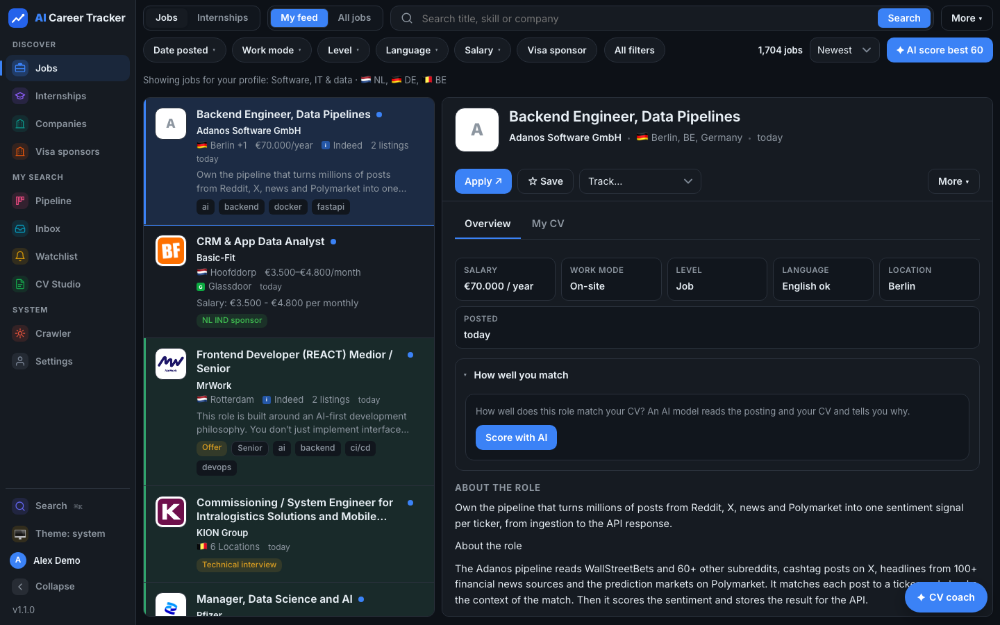
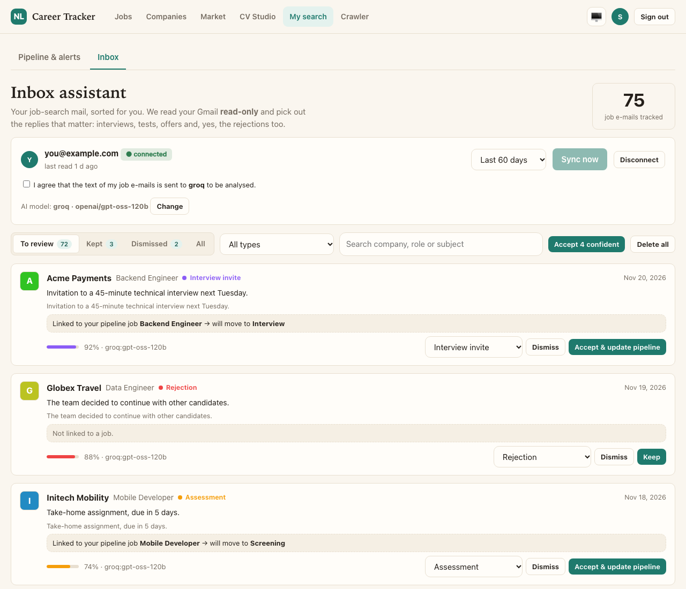
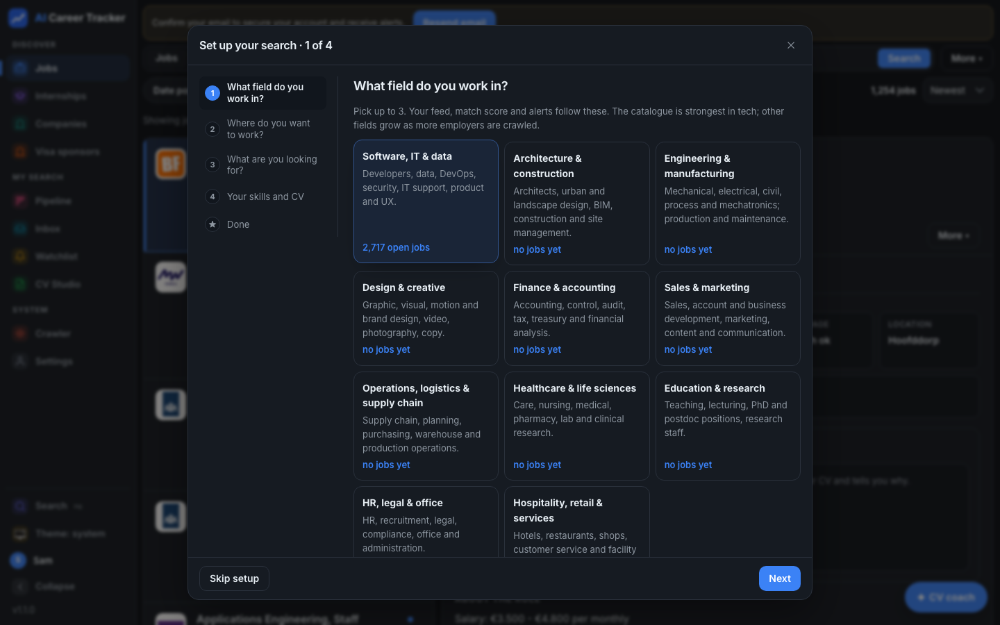
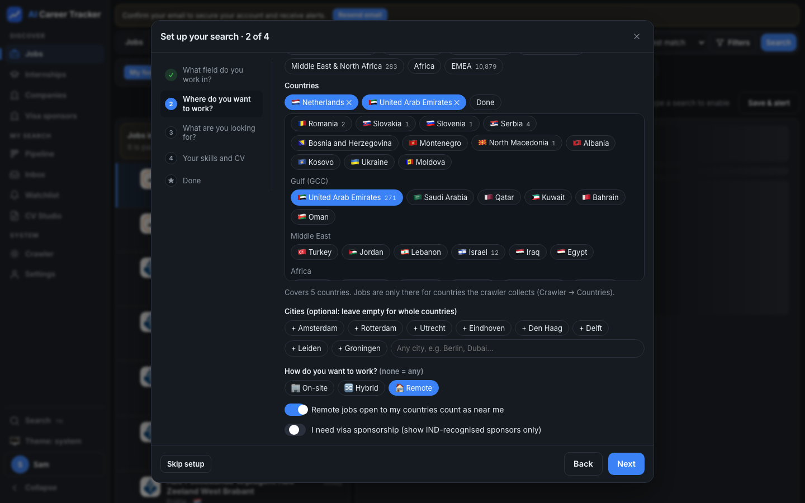
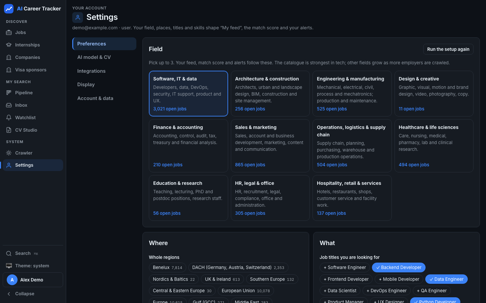
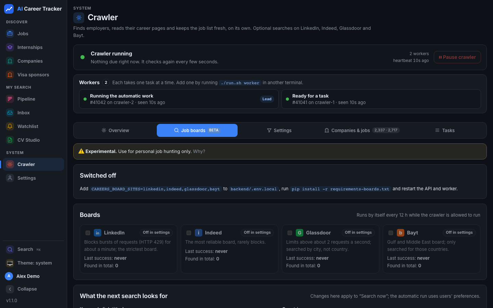
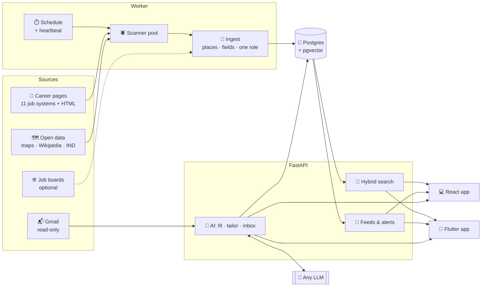
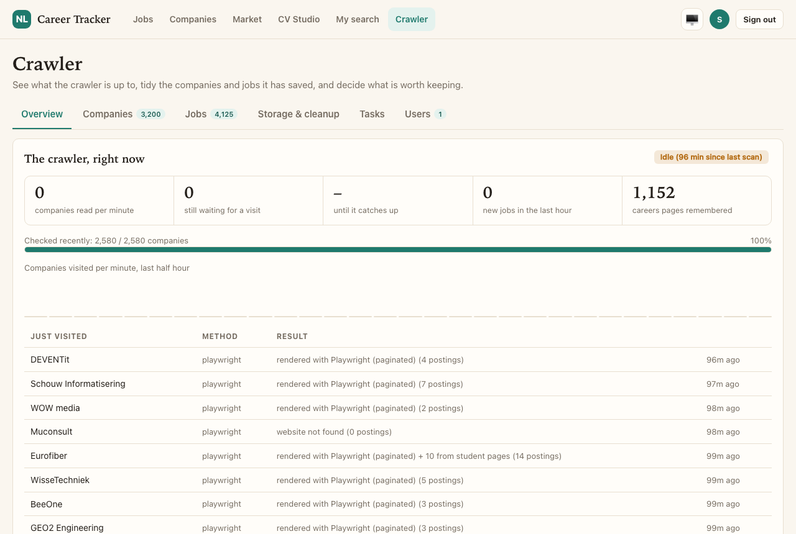
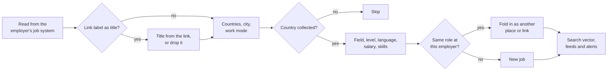

<p align="center"></p>

<h1 align="center">AI Career Tracker</h1>

<h3 align="center">Find work straight from employers. Apply with a CV that fits. Let your inbox move your pipeline.</h3>

<p align="center">
  
  
  
  
  
  
</p>

<p align="center">
  
  
  
  
</p>

<p align="center"><br><sub>▶ 45-second tour · <a href="docs/media/demo.mp4">watch in full quality (MP4)</a></sub></p>

---

## 🏆 What we achieved

<table align="center">
<tr>
<td align="center" width="25%"><h1>6,346</h1><b>employers</b><br><sub>watched on their own career pages</sub></td>
<td align="center" width="25%"><h1>10,965</h1><b>open roles</b><br><sub>one card each, no reposts</sub></td>
<td align="center" width="25%"><h1>1,385</h1><b>duplicates folded</b><br><sub>into 703 multi-city roles</sub></td>
<td align="center" width="25%"><h1>59</h1><b>countries</b><br><sub>Europe · Middle East · Africa</sub></td>
</tr>
<tr>
<td align="center"><h1>11</h1><b>job systems</b><br><sub>Greenhouse, Lever, Workday, Personio…</sub></td>
<td align="center"><h1>11</h1><b>fields</b><br><sub>tech, architecture, engineering, finance…</sub></td>
<td align="center"><h1>13,089</h1><b>visa sponsors</b><br><sub>matched to the IND register</sub></td>
<td align="center"><h1>11</h1><b>AI providers</b><br><sub>Ollama, Claude, OpenAI, Groq…</sub></td>
</tr>
</table>

<sub>Live numbers from the development database at the time of writing.</sub>

## 🖥️ The product in six screens

<table>
<tr>
<td width="33%"><br><b>🔎 Search</b><br><sub>Words and meaning combined, operators, filters for field, country, city, remote, level, salary, visa sponsor.</sub></td>
<td width="33%"><br><b>🧩 One role, one card</b><br><sub>The same role in four cities or on three sites is one job with every link. The employer's link wins.</sub></td>
<td width="33%"><br><b>🎯 My feed</b><br><sub>Your field, countries, titles and CV skills rank every job. New countries are collected for you.</sub></td>
</tr>
<tr>
<td><br><b>📄 CV Studio</b><br><sub>Import PDF, Word, LaTeX or Reactive Resume. Edit live, tailor per job with AI, export PDF.</sub></td>
<td><br><b>🧭 Pipeline</b><br><sub>Shortlisted → offer with timeline, to-dos and response stats. Drag, or let the inbox move it.</sub></td>
<td><br><b>📬 Inbox assistant</b><br><sub>Read-only Gmail: invites, tests, offers and rejections linked to the right job, always undoable.</sub></td>
</tr>
</table>

<details>
<summary><b>More screens</b>: setup dialog, visa sponsors, settings, crawler, job boards, light mode, phone</summary>
<br>
<table>
<tr><td width="50%"></td><td width="50%"></td></tr>
<tr><td></td><td></td></tr>
<tr><td></td><td></td></tr>
<tr><td></td><td align="center"></td></tr>
</table>
</details>

## 🧠 What makes it different

| | |
|---|---|
| **🏢 Employer-direct** | Reads official job-system feeds and career pages. Polite: `robots.txt`, rate limits, a schedule, a named user agent. |
| **🧩 One role, one card** | A role is the employer plus its title without places, gender tags or hours. Repeats fold into one job; junk link labels become real titles. |
| **🌍 Places as data** | "Berlin, de", "DE-Germany-Remote", "Remote - Europe" become countries, city, work mode and remote scope, so country and region filters are exact. |
| **🎯 One catalogue, a feed per person** | Jobs are stored once; each feed is a live view ranked by that person's profile and CV skills. |
| **🛡️ Honest AI** | Fit scores explain themselves and are capped by hard facts; tailored CVs cannot add numbers, employers or skills the original lacks. |
| **🔒 Private by default** | CVs and API keys encrypted at rest, read-only Gmail, self-hosted fonts, full export and delete. |

## 🏗️ How it works



<table>
<tr>
<td width="55%"></td>
<td><b>The same pipeline, explained inside the app.</b><br><br>The Crawler page shows each step (<i>find employers → find careers pages → read postings → understand → keep → tell people</i>) with what it does, when it runs and live numbers.<br><br>It is <b>Running</b>, <b>Paused</b> by its schedule, or <b>Stopped</b>, with a heartbeat. Every task can be paused, resumed or stopped between steps.</td>
</tr>
</table>

<details>
<summary><b>The life of one posting</b></summary>


</details>

<details>
<summary><b>Code structure and tech stack</b></summary>

```
backend/app   api/v1 (routes) · services (search, ingest, alerts, boards, schedule, AI) · crawler (discovery, adapters,
              places, sectors, dedupe) · cvtools · models · workers          migrations: Alembic 0001–0014
frontend/src  app (shell) · features (jobs, cv, pipeline, inbox, admin, onboarding …) · shared/ui (Logo, PageHeader,
              StatTiles, CountUp, EmptyState, kit) · shared/api · styles (tokens → primitives → pages → theme)
```

| Layer | Stack |
|---|---|
| Backend | Python 3.12, FastAPI, SQLAlchemy 2, Alembic, httpx, Playwright for JS career pages |
| Data | Postgres 16, pgvector (HNSW), weighted full-text search, trigram typo tolerance, local ONNX embeddings |
| AI | Provider-agnostic client (OpenAI-compatible + Anthropic), JSON mode with fallbacks, fact guard |
| Web | React 18, strict TypeScript, TanStack Query, React Router, Radix primitives |
| Quality | pytest on real Postgres, Vitest, Playwright end-to-end, scripted screenshots and video |
| Ops | Docker Compose, Caddy HTTPS, Render blueprint, Oracle free-tier guide |
</details>

## 🚀 Run it

```bash
git clone https://github.com/emelian-chkaira/nl-career-tracker.git && cd nl-career-tracker
./setup.sh          # needs only Docker: installs, migrates, loads starter data, starts everything
```

Open **http://localhost:8787** and register; the first account is the admin. The starter data holds 3,200 companies, 4,000+ listings and the IND register, so the app is full from the first minute.

<details>
<summary><b>Manual setup</b></summary>

```bash
docker compose up -d db                        # Postgres + pgvector on :5433
cd backend && python3 -m venv .venv && .venv/bin/pip install -r requirements-dev.txt
.venv/bin/playwright install chromium
cp ../.env.example ../.env                     # set CAREERS_JWT_SECRET
./run.sh api                                   # http://localhost:8787 · API docs at /api/docs
./run.sh worker                                # second terminal: crawling, alerts, embeddings
cd ../frontend && npm install && npm run dev   # http://localhost:5173
```
</details>

<details>
<summary><b>Configuration</b></summary>

| Variable | Purpose |
|---|---|
| `CAREERS_CRAWL_COUNTRIES` | Countries or regions to collect, e.g. `NL,BE,DE` or `benelux,gcc` (also on the Crawler page) |
| `CAREERS_KEEP_REMOTE` | Also keep remote jobs open to those countries |
| `CAREERS_KEEP_DOMAINS`, `CAREERS_MAX_JOB_AGE_DAYS`, `CAREERS_DELETE_EXPIRED_AFTER_DAYS` | What is stored and for how long |
| `CAREERS_FIREBASE_API_KEY`, `CAREERS_GOOGLE_CLIENT_ID` | Firebase and Google sign-in (without them: built-in e-mail sign-in) |
| `CAREERS_SMTP_*`, `CAREERS_MAIL_FROM` | Alert and account e-mails |
| `CAREERS_OPEN_CRAWLER`, `CAREERS_ALLOW_PRIVATE_HOSTS` | Set both to `false` on a public server |
| `CAREERS_BOARD_SITES` | Optional job boards, see below |

The crawl schedule (days, hours, revisit interval, parallel sites) is set on the Crawler page. Everything else: [.env.example](.env.example).
</details>

<details>
<summary><b>AI models</b></summary>

**Ollama** on your own computer, or your own key for **Claude**, **OpenAI**, **Groq**, **OpenRouter**, **Grok**, **DeepSeek**, **Qwen**, **Kimi**, **GLM**, or any OpenAI-compatible endpoint. Choose a model per task (scoring, tailoring, inbox, assistant). Keys are encrypted and never sent back to the browser.
</details>

<details>
<summary><b>Optional job boards: LinkedIn, Indeed, Glassdoor, Bayt</b></summary>

Off by default. Uses the open-source [JobSpy](https://github.com/speedyapply/JobSpy) library (MIT). These boards' terms do not allow automated searching, so it is meant for personal use and never fights a block: one board at a time, spaced requests, and a board that blocks it rests (10 minutes for LinkedIn, doubling each time).

```bash
cd backend && .venv/bin/pip install -r requirements-boards.txt
echo "CAREERS_BOARD_SITES=linkedin,indeed,glassdoor,bayt" >> .env.local
```

Crawler → **Job boards** shows each board's health and exactly which keywords and countries the next search uses.
</details>

<details>
<summary><b>Tests, media and deployment</b></summary>

```bash
cd backend && .venv/bin/python -m pytest tests -q   # 165 tests on a real Postgres
cd frontend && npx vitest run && npx playwright test # 16 unit + 8 end-to-end
cd frontend && npm run media                         # re-make screenshots and the demo video
```

Deploy for free with [Oracle Cloud](docs/DEPLOY_ORACLE.md) or [Render](docs/DEPLOY_RENDER.md); sign-in via [Firebase](docs/FIREBASE.md); inbox via [Gmail OAuth](docs/GMAIL_OAUTH.md). Read [DATA_SOURCES.md](DATA_SOURCES.md) first and set `CAREERS_CONTACT`.
</details>

---

<p align="center"><sub>📱 Native app: <a href="https://github.com/emelian-chkaira/nl-career-tracker-mobile">nl-career-tracker-mobile</a> · 📐 <a href="PLAN.md">Design notes</a> · ⚖️ <a href="docs/JOBOPS_COMPARISON.md">Compared with JobOps</a> · 🤝 <a href="CONTRIBUTING.md">Contributing</a> · MIT licensed</sub></p>
