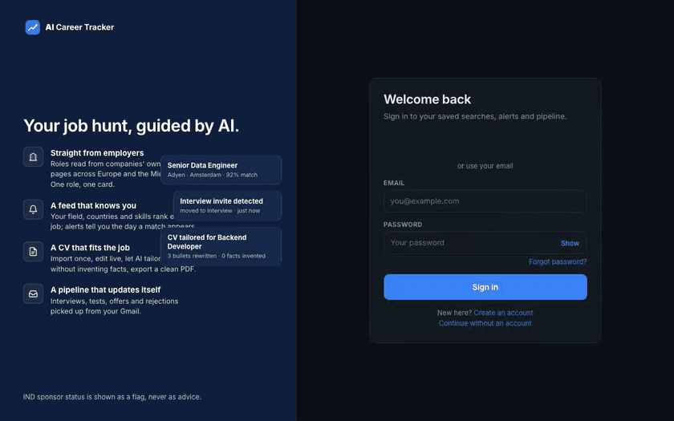
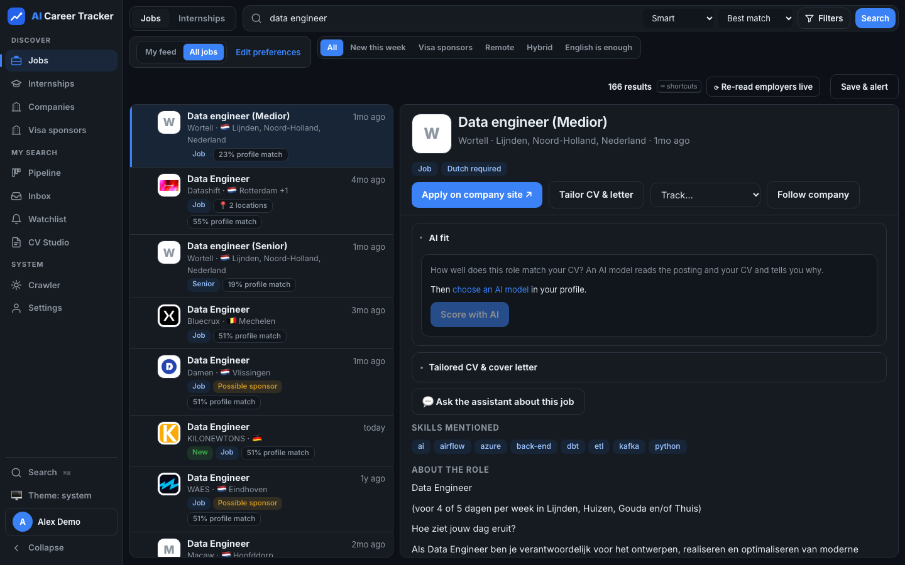
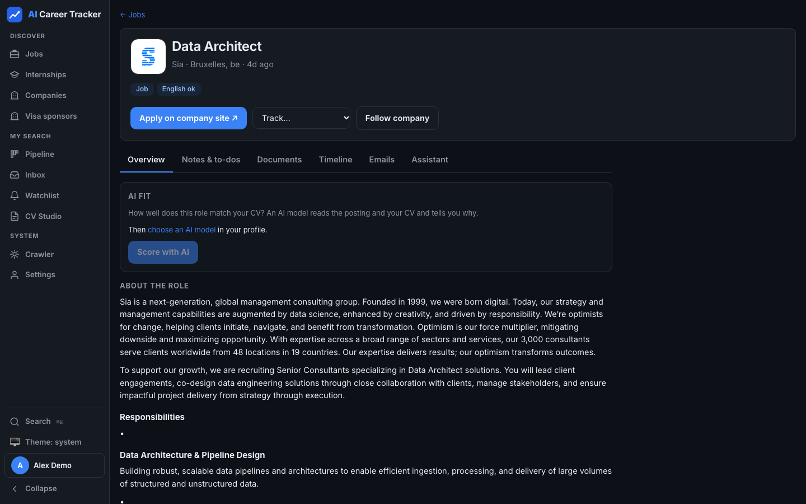
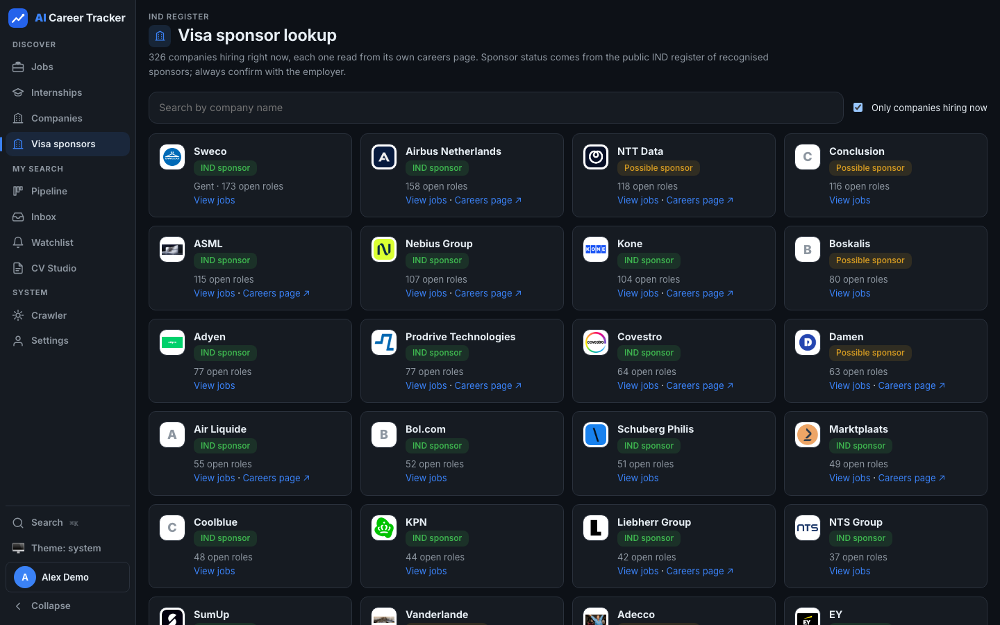
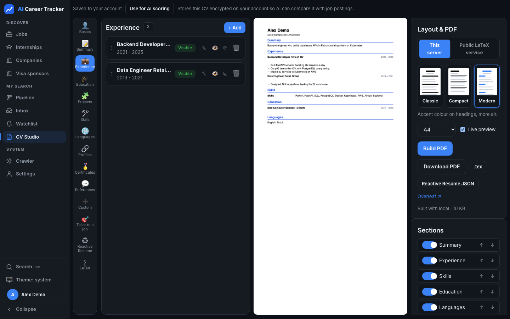
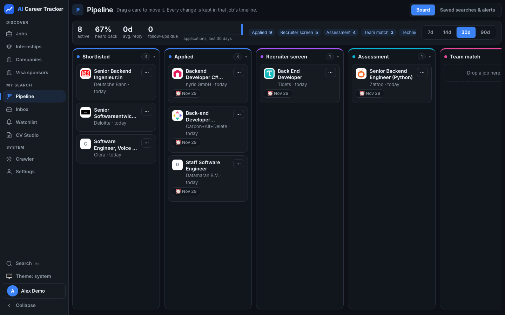
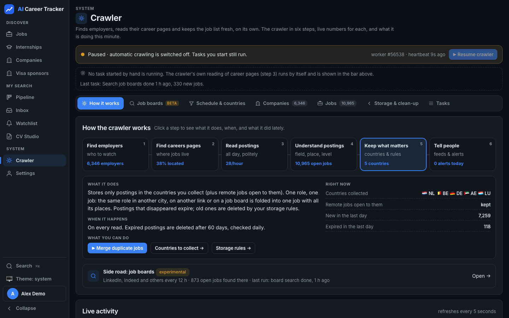
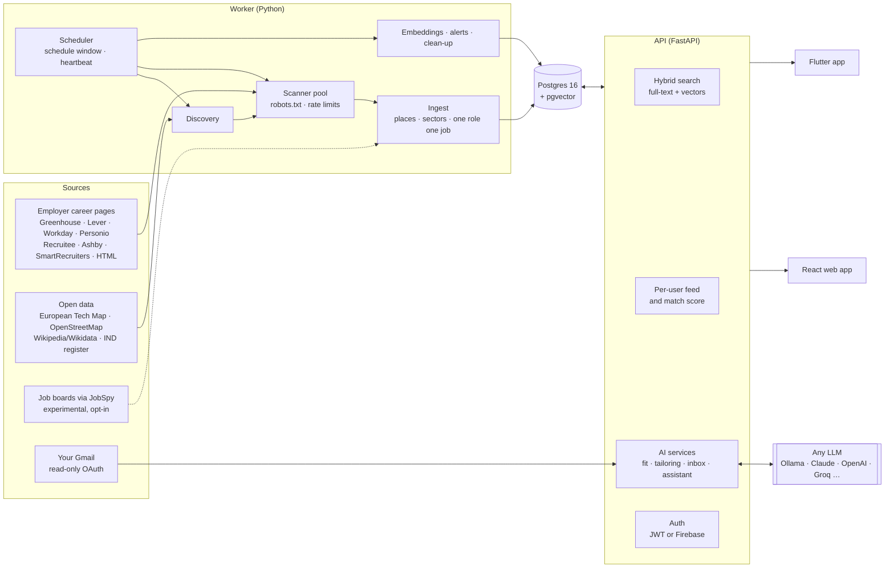
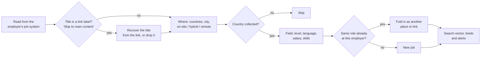

<p align="center"></p>

<h1 align="center">AI Career Tracker</h1>

<p align="center"><b>Jobs straight from employers' own career pages, an AI that tailors your CV per role without inventing facts,<br>and a pipeline that updates itself from your inbox.</b></p>

<p align="center">
  
  
  
  
  
  
</p>

<p align="center"><a href="#see-it-in-action">Demo</a> · <a href="#what-it-does">Features</a> · <a href="#how-it-works">Architecture</a> · <a href="#quick-start">Quick start</a> · <a href="#configuration">Configuration</a></p>

---

## See it in action

<p align="center"></p>
<p align="center"><sub>45-second tour · <a href="docs/media/demo.mp4">watch it as MP4</a></sub></p>

## Why it exists

Job boards repost the same role five times, show postings that closed weeks ago, and sit between you and the employer.
AI Career Tracker **goes to the source**. It discovers employers, finds their real career pages and job systems, reads every posting itself, and keeps **one card per role**.
Around that clean list it adds what a serious job search needs: a feed that knows your field and countries, a CV Studio with an honest AI, and a pipeline that moves itself when the interview invite lands in your inbox.

| | Typical job board | AI Career Tracker |
|---|---|---|
| Where jobs come from | Reposts, agencies, scraped feeds | The employer's own career page or job system |
| The same role in 4 cities | 4 cards | **1 card**, all 4 places listed |
| Closed postings | Linger for weeks | Expire when they leave the employer's page |
| Your CV | Upload, hope | Edit live, AI-tailored per role, facts guarded |
| Replies in your inbox | You update a spreadsheet | Detected and applied to your pipeline |

## What we achieved

<table>
<tr>
<td align="center"><h3>6,346</h3>employers watched</td>
<td align="center"><h3>10,965</h3>open roles, one card each</td>
<td align="center"><h3>59</h3>countries in Europe, the Middle East and Africa</td>
<td align="center"><h3>11</h3>fields, from tech to architecture</td>
</tr>
<tr>
<td align="center"><h3>11</h3>job systems read natively</td>
<td align="center"><h3>13,089</h3>IND visa sponsors matched</td>
<td align="center"><h3>1,385</h3>repeat listings folded into 703 roles</td>
<td align="center"><h3>11</h3>AI providers, bring your own</td>
</tr>
</table>

<sub>Numbers from the local development database at the time of writing; they move every hour the crawler runs.</sub>

## What it does

### Find work

<table>
<tr>
<td width="50%"><br><b>Search that understands you.</b> Keyword and meaning search combined, operators (<code>flutter -senior</code>, <code>"data engineer"</code>), filters for field, country, region, city, remote / hybrid, level, language, salary and visa sponsors.</td>
<td width="50%"><br><b>My feed.</b> One shared catalogue, a personal view: your fields, countries, titles and CV skills rank every job. Picking a new country makes the crawler start collecting it, and the list tells you while it fills.</td>
</tr>
<tr>
<td><br><b>One role, one card.</b> The same role in Mainz, Munich and Mannheim, or on the employer's site and two job boards, is one job with all its links. The employer's own link always wins.</td>
<td><br><b>Visa sponsors.</b> Every employer is matched against the public IND register of recognised sponsors, shown as a flag, never as advice.</td>
</tr>
<tr>
<td><br><b>Set up in a minute.</b> After sign-up: your field, then…</td>
<td><br>…your countries or whole regions (Benelux, DACH, Gulf…), work mode, titles and skills, or just your CV.</td>
</tr>
</table>

### Apply better

<table>
<tr>
<td width="50%"><br><b>CV Studio.</b> Import a PDF, Word, LaTeX or Reactive Resume file, edit section by section and watch the PDF rebuild as you type. Three layouts, section toggles, export to PDF, LaTeX or Reactive Resume.</td>
<td width="50%"><br><b>Pipeline.</b> Shortlisted → applied → interview → offer, with a timeline, to-dos and response stats per job. Drag a card, or let the inbox move it.</td>
</tr>
<tr>
<td><br><b>Inbox assistant.</b> Reads your Gmail read-only, finds interview invites, tests, offers and rejections and links them to the right job. You review each one, or let very confident matches apply themselves, always undoable.</td>
<td><br><b>Your AI, your choice.</b> Ollama on your own machine, or your own key for Claude, OpenAI, Groq, OpenRouter, Grok, DeepSeek, Qwen, Kimi or GLM. Pick a model per task: scoring, tailoring, inbox, assistant.</td>
</tr>
</table>

**AI that does not make things up.** The fit score explains itself (strengths, gaps, deal-breakers) and is capped by hard facts the server knows, such as "Dutch required, your CV lists no Dutch". Tailored CVs may reword and reorder, but a fact guard rejects new numbers, employers or skills the original CV does not contain.

### Run the crawler

<table>
<tr>
<td width="50%"><br><b>See it work.</b> Running, paused by its schedule, or stopped, with a heartbeat. Six steps, each explaining what it does, when it runs and what it did in the last hour.</td>
<td width="50%"><br><b>Explained, then actionable.</b> Every step has its own buttons: find employers in a country, re-scan, merge duplicates, change the schedule.</td>
</tr>
<tr>
<td><br><b>Tidy what is stored.</b> Filter companies and jobs by country, city, field, work mode and source; bulk expire or delete exactly what you see.</td>
<td><br><b>Job boards (experimental, own branch).</b> Optional LinkedIn, Indeed, Glassdoor and Bayt search with the exact keywords shown beforehand, per-board health, and polite back-off after a block.</td>
</tr>
</table>

<p align="center">&nbsp;&nbsp;</p>
<p align="center"><sub>Light mode and phone width. A native Flutter app lives in <a href="https://github.com/emelian-chkaira/nl-career-tracker-mobile">its own repository</a>.</sub></p>

## How it works

### The system



### The life of one posting



### Design decisions

- **Employer-direct.** The crawler reads official job-system feeds and career pages, honours `robots.txt`, rate-limits per site and names itself in its user agent. A schedule decides when it may run, and a heartbeat shows whether it is running, paused or stopped.
- **One role, one job.** A role's identity is the employer plus the title without places, gender tags, hours or prefixes (`crawler/dedupe.py`). Repeats are folded into the job as extra places and links, both on arrival and in a daily clean-up that can also undo wrong groups.
- **Places are data, not strings.** `crawler/places.py` reads "Berlin, de", "DE-Germany-Remote" and "Amsterdam; Prague; Remote - Europe" into countries, a city, a work mode and who a remote job is open to, so filtering by country or region is exact.
- **One catalogue, many feeds.** Jobs are stored once; each user's feed is a query-time view filtered and ranked by their profile and CV skills. Choosing a new country makes the crawler collect it.
- **Bring your own AI.** Every AI feature talks to an interchangeable provider chosen per user and per task. Postings and CVs are treated as data, never as instructions.
- **Privacy by default.** CVs and API keys are encrypted at rest, Gmail is read-only and only extracted facts are stored, fonts are self-hosted, and you can export or delete everything.

### Code structure

```
backend/app
├── api/v1/        HTTP routes: auth, jobs, me, admin (crawler), cv, fit, mail, track, rr …
├── services/      business logic: search, jobs, ingest, alerts, boards, schedule, coverage, fit, tailor …
├── crawler/       discovery, job-system adapters, places, sectors, dedupe, boards (JobSpy)
├── cvtools/       CV parsing, LaTeX templates, Reactive Resume conversion
├── models/        SQLAlchemy models          migrations/  Alembic (0001–0014)
└── workers/       the worker loop and its tasks (pause / resume / stop between steps)

frontend/src
├── app/           shell and routes
├── features/      one folder per feature: jobs, cv, pipeline, inbox, admin (crawler), onboarding …
├── shared/api/    typed client, API types, shared queries
├── shared/ui/     Logo, PageHeader, StatTiles, CountUp, EmptyState, BoardIcon, kit (Panel, Drawer, Modal, Tabs …)
└── styles/        tokens → primitives → shell → pages → features → motion → theme, one topic per file
```

### Tech stack

| Layer | Choices |
|---|---|
| Backend | Python 3.12, FastAPI, SQLAlchemy 2, Alembic, Pydantic settings, httpx, BeautifulSoup, Playwright (JS career pages) |
| Data | Postgres 16, pgvector (HNSW), full-text search with weighted fields, trigram typo tolerance, local ONNX embeddings |
| AI | Provider-agnostic client (OpenAI-compatible + Anthropic), JSON-mode with fallbacks, fact guard for tailoring |
| Web | React 18, TypeScript (strict), TanStack Query, React Router, Radix primitives, self-hosted Inter |
| Mobile | Flutter (separate repository) |
| Quality | pytest on a real Postgres (165 tests), Vitest (16), Playwright end-to-end (8), scripted docs media |
| Ops | Docker Compose, Caddy (HTTPS), Render blueprint, Oracle Cloud free-tier guide |

## Quick start

You need **Docker**. The script installs the rest, creates the tables and loads **starter data** (3,200 Dutch tech companies, 4,000+ listings, the IND sponsor register), so the app is full the moment it opens.

```bash
git clone https://github.com/emelian-chkaira/nl-career-tracker.git
cd nl-career-tracker
./setup.sh
```

Open **http://localhost:8787** and register; the first account becomes the admin. Options: `--docker` (everything in containers) · `--no-start` · `--no-browser`. Safe to run again.

<details>
<summary><b>Manual setup</b></summary>

```bash
docker compose up -d db                       # Postgres + pgvector on localhost:5433
cd backend
python3 -m venv .venv && .venv/bin/pip install -r requirements-dev.txt
.venv/bin/playwright install chromium         # JS-rendered career pages
cp ../.env.example ../.env                    # set CAREERS_JWT_SECRET
./run.sh api                                  # migrates, then http://localhost:8787  (API docs: /api/docs)
PYTHONPATH=. .venv/bin/python -m app.cli seed # optional: starter data
./run.sh worker                               # second terminal: crawling, alerts, embeddings
cd ../frontend && npm install && npm run dev  # http://localhost:5173 (proxies /api to :8787)
```

Without a Firebase key the app uses its own e-mail/password sign-in, so local development needs no cloud account.
</details>

## Configuration

Everything is an environment variable; see [.env.example](.env.example) and `backend/app/core/config.py`.

| Variable | Purpose |
|---|---|
| `DATABASE_URL`, `CAREERS_JWT_SECRET`, `CAREERS_ADMIN_EMAILS` | Core settings (the JWT secret is mandatory in production) |
| `CAREERS_CRAWL_COUNTRIES` | Countries or regions to collect, e.g. `NL,BE,DE` or `benelux,gcc` (also editable on the Crawler page) |
| `CAREERS_KEEP_REMOTE` | Also keep remote jobs open to those countries ("Remote - Europe", "Anywhere") |
| `CAREERS_KEEP_DOMAINS`, `CAREERS_MAX_JOB_AGE_DAYS`, `CAREERS_DELETE_EXPIRED_AFTER_DAYS` | What is stored and for how long |
| `CAREERS_FIREBASE_API_KEY`, `CAREERS_GOOGLE_CLIENT_ID` | Firebase sign-in and the Google button |
| `CAREERS_SMTP_*`, `CAREERS_MAIL_FROM` | Alert and account e-mails (any SMTP relay) |
| `CAREERS_OPEN_CRAWLER` | `true`: any signed-in user can use the Crawler page; `false` on a public site |
| `CAREERS_ALLOW_PRIVATE_HOSTS` | `true` lets AI settings point at Ollama on your network; `false` on a public server |
| `CAREERS_BOARD_SITES`, `CAREERS_BOARD_*` | Experimental job boards (branch `experimental/job-boards` only) |

The crawl schedule (days, hours, revisit interval, parallel sites) lives on the Crawler page and is stored in the database.

<details>
<summary><b>AI models</b></summary>

| Choice | Notes |
|---|---|
| **Ollama** | Run Qwen, DeepSeek or Llama on your own computer: free and private |
| **Groq**, **OpenRouter** | Free tiers available; OpenRouter gives one key for many models |
| **Claude**, **OpenAI**, **Grok** | Your own API key; pick a lighter model for scoring and inbox, a stronger one for tailoring |
| **DeepSeek**, **Qwen**, **Kimi**, **GLM** | OpenAI-compatible APIs, often very cheap |
| **Custom** | Any OpenAI-compatible endpoint: vLLM, LM Studio, LiteLLM, a company gateway |

Keys are encrypted at rest and never sent back to the browser.
</details>

## Testing

```bash
cd backend && .venv/bin/python -m pytest tests -q     # 165 tests on a real Postgres
cd frontend && npx vitest run                         # 16 unit tests
cd frontend && npx playwright test                    # 8 end-to-end tests against a running app
cd frontend && npm run media                          # re-make docs/screenshots and docs/media (see playwright.media.config.ts)
```

## Deploy

| Guide | What you get |
|---|---|
| [docs/DEPLOY_ORACLE.md](docs/DEPLOY_ORACLE.md) | Oracle Cloud *Always Free* VM, free domain, Caddy HTTPS, backups |
| [docs/DEPLOY_RENDER.md](docs/DEPLOY_RENDER.md) | One-click Render blueprint with a managed Postgres |
| [docs/FIREBASE.md](docs/FIREBASE.md) · [docs/GMAIL_OAUTH.md](docs/GMAIL_OAUTH.md) | Sign-in with e-mail and Google; read-only Gmail for the inbox |

Read [DATA_SOURCES.md](DATA_SOURCES.md) first (licences, attribution, crawler etiquette) and set `CAREERS_CONTACT` so site owners can reach you.

## Experimental: job boards

On the branch `experimental/job-boards` only. It optionally searches **LinkedIn, Indeed, Glassdoor, Google Jobs and Bayt** through the open-source [JobSpy](https://github.com/speedyapply/JobSpy) library (MIT).
These boards' terms of use do not allow automated searching, so it is off by default and meant for personal use. It never fights a block: one board at a time, spaced requests, and a board that blocks it rests (10 minutes for LinkedIn, doubling if it happens again).

```bash
cd backend && .venv/bin/pip install -r requirements-boards.txt
# backend/.env.local
CAREERS_BOARD_SITES=linkedin,indeed,glassdoor,bayt
```

Crawler → **Job boards** shows each board's health and exactly which keywords and countries the next search will use, before it runs.

## Status

Built and tested locally. Prepared but not yet exercised in production: the first public deployment, the mobile Google button against a live client, and Reactive Resume against a live instance. AI tailoring and scoring are covered by tests with mocked models.

## More

[PLAN.md](PLAN.md) design notes · [DATA_SOURCES.md](DATA_SOURCES.md) data licences and etiquette · [CONTRIBUTING.md](CONTRIBUTING.md) · [docs/JOBOPS_COMPARISON.md](docs/JOBOPS_COMPARISON.md) how it compares to JobOps · MIT licensed.
