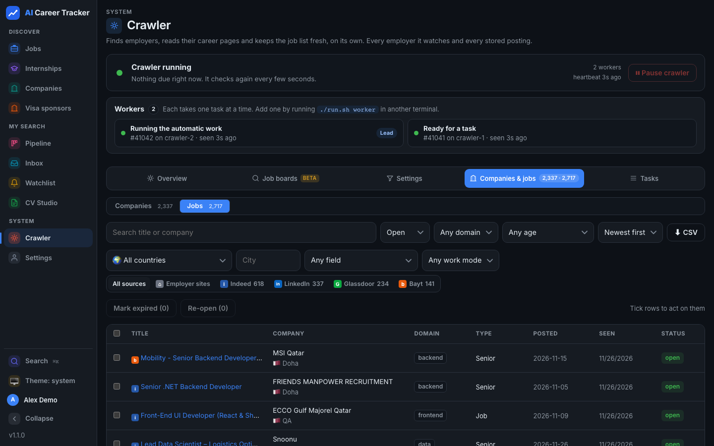
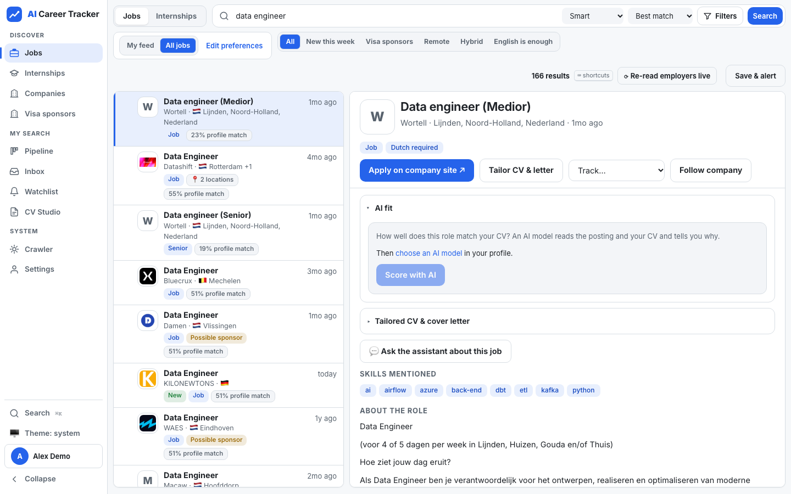
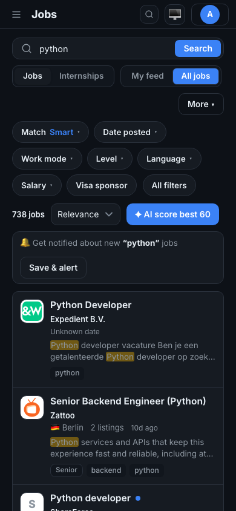
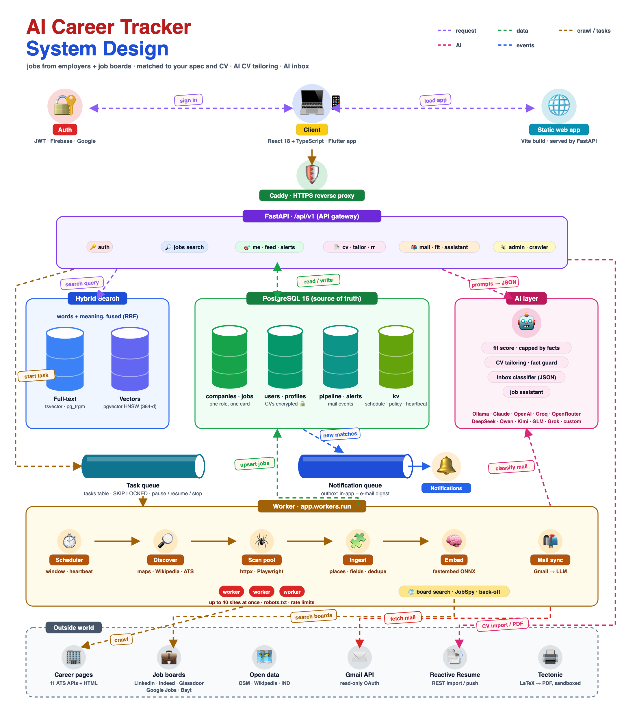
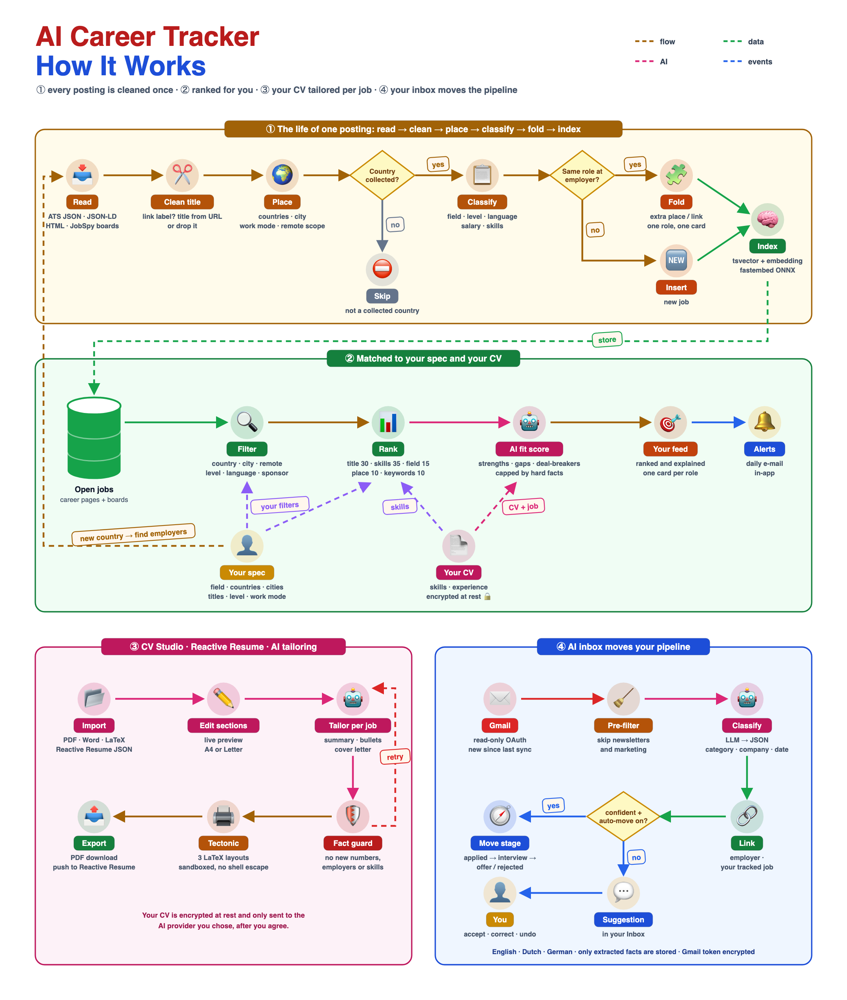
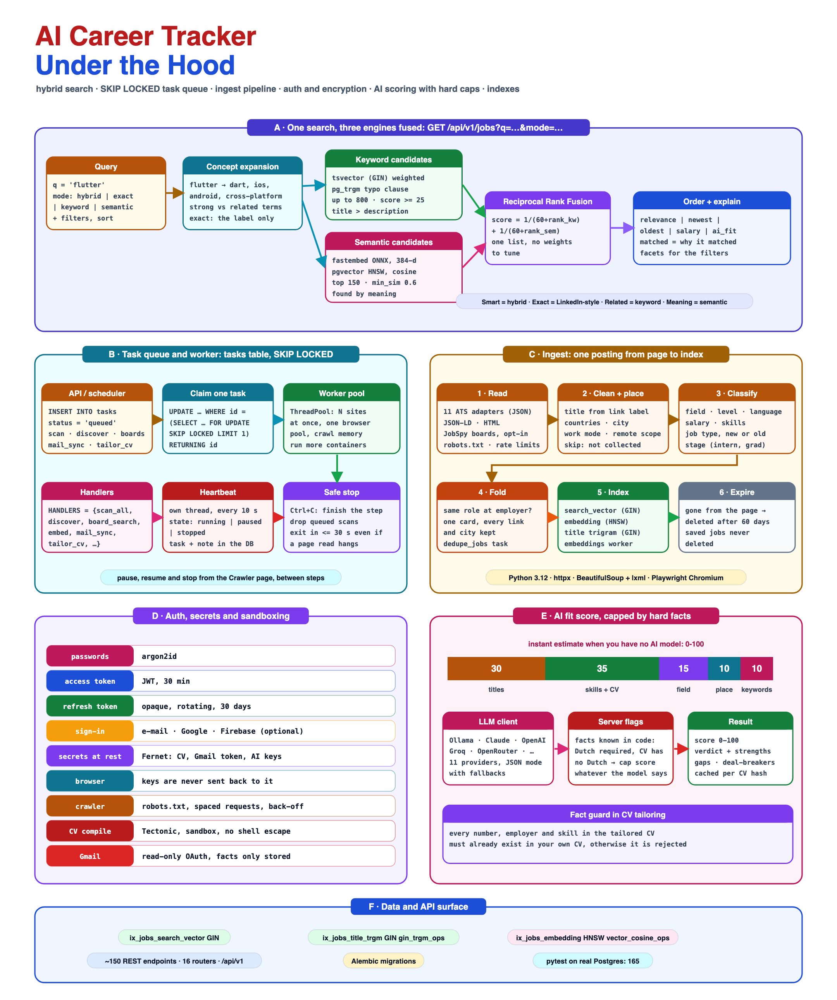

<h1 align="center"></h1>

<p align="center">AI Career Tracker is an open-source job-search platform: a FastAPI and PostgreSQL backend, a React web app, a Flutter mobile app and a crawler that reads employers' own career pages.</p>

<p align="center">
  <a href="https://ai-career-tracker-gmwn.onrender.com"></a>
  <a href="https://emelianchkaira.netlify.app"></a>
</p>

<p align="center">
  <a href="https://github.com/emelian-chkaira/ai-career-tracker/actions/workflows/backend.yml"></a>
  <a href="https://github.com/emelian-chkaira/ai-career-tracker/actions/workflows/frontend.yml"></a>
  
  
</p>

<p align="center"><sub>The demo opens with one click, no sign-up. It shows a saved snapshot of jobs and a Crawler page with sample data; the real crawler runs on your own computer. It is on free hosting, so the first visit can take about a minute.</sub></p>

<p align="center">
  
  
  
  
  
  
  
</p>

<p align="center">
  
  
  
  
  
  
  
  
  
  
  
  
  
  
  
  
  
  
</p>

<p align="center"><br><sub>▶ 45-second tour · <a href="docs/media/demo.mp4">watch in full quality (MP4)</a></sub></p>

---

## 🏆 What we achieved

<table align="center">
<tr>
<td align="center" width="25%"><h1>6,583</h1><b>employers</b><br><sub>watched on their own career pages</sub></td>
<td align="center" width="25%"><h1>11,086</h1><b>open roles</b><br><sub>one card each, no reposts</sub></td>
<td align="center" width="25%"><h1>1,818</h1><b>duplicates folded</b><br><sub>into 902 multi-link roles</sub></td>
<td align="center" width="25%"><h1>59</h1><b>countries</b><br><sub>Europe · Middle East · Africa</sub></td>
</tr>
<tr>
<td align="center"><h1>11</h1><b>job systems</b><br><sub>Greenhouse, Lever, Workday, Personio…</sub></td>
<td align="center"><h1>11</h1><b>fields</b><br><sub>tech, architecture, engineering, finance…</sub></td>
<td align="center"><h1>13,089</h1><b>visa sponsors</b><br><sub>matched to the NL IND register</sub></td>
<td align="center"><h1>11</h1><b>AI providers</b><br><sub>Ollama, Claude, OpenAI, Groq…</sub></td>
</tr>
</table>

<sub>Live numbers from the development database at the time of writing.</sub>

## 🖥️ The product in six screens

<table>
<tr>
<td width="33%"><br><b>🔎 Search</b><br><sub>Words and meaning combined, operators, filters for field, country, city, remote, level, salary, visa sponsor.</sub></td>
<td width="33%"><br><b>🧩 One role, one card</b><br><sub>The same role in four cities or on three sites is one job with every link. The employer's link wins.</sub></td>
<td width="33%"><br><b>🎯 My feed</b><br><sub>Your field, countries, titles and CV skills rank every job. New countries are collected for you.</sub></td>
</tr>
<tr>
<td><br><b>📄 CV Studio</b><br><sub>Import PDF, Word, LaTeX or Reactive Resume. Edit live, tailor per job with AI, export PDF.</sub></td>
<td><br><b>🧭 Pipeline</b><br><sub>Shortlisted → offer with timeline, to-dos and response stats. Drag, or let the inbox move it.</sub></td>
<td><br><b>📬 Inbox assistant</b><br><sub>Read-only Gmail: invites, tests, offers and rejections linked to the right job, always undoable.</sub></td>
</tr>
</table>

<details>
<summary><b>More screens</b>: setup dialog, visa sponsors, settings, crawler, job boards, light mode, phone</summary>
<br>
<table>
<tr><td width="50%"></td><td width="50%"></td></tr>
<tr><td></td><td></td></tr>
<tr><td></td><td></td></tr>
<tr><td></td><td align="center"></td></tr>
</table>
</details>

## 🎯 Jobs customized to your spec and your CV

You tell it what you want once: **field, countries or regions, cities, job titles, level, work mode, language, visa needs**, and upload your **CV**. From then on every job, from an employer's career page or from a job board, is filtered and ranked for you (flow ② in [How it works](#️-architecture)).

- **Employer-direct first, boards on top.** Career pages are crawled continuously. LinkedIn, Indeed, Glassdoor and Bayt are searched with *your* job titles in *your* countries (via [JobSpy](https://github.com/speedyapply/JobSpy), opt-in), and the Crawler page shows the exact keywords before it runs.
- **Your countries drive the crawler.** Pick the UAE or Germany in your profile and the crawler starts finding employers there; the job list tells you while it fills.
- **CV-aware ranking.** Skills read from your CV join your profile skills in the match score; with an AI model the fit score explains itself and is capped by hard facts ("Dutch required, your CV lists no Dutch").

## 📄 CV Studio, Reactive Resume and AI tailoring

| | |
|---|---|
| **Import anything** | PDF, Word, LaTeX or **Reactive Resume** JSON is parsed into structured sections you can edit one by one. |
| **Real typesetting** | Three LaTeX layouts compiled by **Tectonic** in a sandbox (no shell escape), rebuilt live as you type; A4 or Letter. |
| **Reactive Resume** | Connect your own Reactive Resume instance (REST API key): import a resume, push your edits back, export its PDF. |
| **AI tailoring per job** | Rewrites your summary and bullets for one posting and writes the cover letter. A **fact guard** rejects any new number, employer or skill your CV does not already contain. |
| **Private** | Your CV is encrypted at rest and only sent to the AI provider you chose, after you agree. |

## 📬 AI that reads your mail and moves your pipeline

Interview invites, assessments, offers, rejections and recruiter messages are recognised in English, Dutch and German. Only the extracted facts are stored, never the e-mail text, and the Gmail token is encrypted (flow ④ in [How it works](#️-architecture)).

## 🏗️ Architecture

**System design:** every part of the system and how they talk.

<p align="center"></p>

**How it works:** the life of one posting, how jobs are matched to your spec and CV, CV tailoring, and the AI inbox.

<p align="center"></p>

**Under the hood:** the technical view. How hybrid search fuses three engines, the `SKIP LOCKED` task queue, the ingest pipeline, auth and encryption, AI scoring with hard caps, and the indexes behind it.

<p align="center"></p>

<sub>Vector versions: <a href="docs/media/system-design.svg">system-design.svg</a> · <a href="docs/media/how-it-works.svg">how-it-works.svg</a> · <a href="docs/media/technical.svg">technical.svg</a> · regenerate with <code>python3 docs/media/system_design.py</code>, <code>how_it_works.py</code> and <code>technical.py</code></sub>

<table>
<tr>
<td width="55%"></td>
<td><b>The same pipeline, inside the app.</b><br><br>The Crawler page shows each step with what it does, when it runs and live numbers. It is <b>Running</b>, <b>Paused</b> by its schedule, or <b>Stopped</b>, with a heartbeat, and every task can be paused, resumed or stopped between steps.</td>
</tr>
</table>

## 🧰 Technology

| Layer | Technologies |
|---|---|
| **API** | Python 3.12 · FastAPI · Pydantic v2 · SQLAlchemy 2 · Alembic · Uvicorn · PyJWT · Argon2 · cryptography (Fernet) |
| **Data & search** | PostgreSQL 16 · pgvector (HNSW) · weighted full-text `tsvector` · `pg_trgm` typo tolerance · reciprocal rank fusion · fastembed (ONNX) embeddings |
| **Crawling** | httpx · BeautifulSoup + lxml · Playwright (Chromium) · 11 ATS adapters (Greenhouse, Lever, Workday, Personio, Ashby, Recruitee, SmartRecruiters, Teamtailor, BambooHR, Workable, Homerun) · JSON-LD · robots.txt |
| **Job boards** | JobSpy: LinkedIn · Indeed · Glassdoor · Bayt, with per-board health and back-off |
| **CV** | pypdf · pdfminer.six · LaTeX templates compiled by Tectonic · Reactive Resume REST API and JSON |
| **AI** | Provider-agnostic LLM client: Ollama · Claude · OpenAI · Groq · OpenRouter · DeepSeek · Qwen · Kimi · GLM · Grok · any OpenAI-compatible endpoint; JSON mode with fallbacks; fact guard |
| **Mail & auth** | Gmail API (read-only OAuth) · Firebase Auth · Google Sign-In · SMTP alerts |
| **Web** | React 18 · TypeScript (strict) · Vite · TanStack Query & Virtual · React Router · Radix UI · cmdk · Recharts · Sonner |
| **Mobile** | Flutter ([separate repository](https://github.com/emelian-chkaira/ai-career-tracker-mobile)) |
| **Quality** | pytest on real Postgres (229) · Vitest + Testing Library (28) · Playwright end-to-end · scripted screenshots and video |
| **Ops** | Docker Compose · Caddy (HTTPS) · Render · Neon Postgres · Oracle Cloud free tier · GitHub Actions CI |

## 🌍 Deployment and CI/CD

**Live demo:** [ai-career-tracker-gmwn.onrender.com](https://ai-career-tracker-gmwn.onrender.com)

| Piece | How it runs |
|---|---|
| **Hosting** | [Render](https://render.com) web service built from the `Dockerfile` (API and web app in one container), Frankfurt, defined in [`render.yaml`](render.yaml) |
| **Database** | [Neon](https://neon.com) serverless Postgres with pgvector, Frankfurt, over a direct (unpooled) connection |
| **Continuous integration** | GitHub Actions: backend tests against a real Postgres with pgvector; frontend unit tests and production build |
| **Continuous deployment** | A push to the `demo` branch is built and deployed by Render; Alembic migrations run when the API starts |
| **Demo mode** | One-click guest accounts, a feature tour, and a Crawler page with made-up data. No crawler worker runs online |

Releasing: merge `main` into `demo` and push. Full guide: [docs/DEPLOY_RENDER.md](docs/DEPLOY_RENDER.md).

## 🚀 Run it

```bash
git clone https://github.com/emelian-chkaira/ai-career-tracker.git && cd ai-career-tracker
./setup.sh          # needs only Docker: installs, migrates, loads starter data, starts everything
```

Open **http://localhost:8787** and register; the first account is the admin. The starter data holds 6,583 companies, 11,000+ listings and the NL IND register, so the app is full from the first minute.

<details>
<summary><b>Manual setup</b></summary>

```bash
docker compose up -d db                        # Postgres + pgvector on :5433
cd backend && python3 -m venv .venv && .venv/bin/pip install -r requirements-dev.txt
.venv/bin/playwright install chromium
cp ../.env.example ../.env                     # set CAREERS_JWT_SECRET
./run.sh api                                   # http://localhost:8787 · API docs at /api/docs
./run.sh worker                                # second terminal: crawling, alerts, embeddings (run it again for more workers)
cd ../frontend && npm install && npm run dev   # http://localhost:5173
```
</details>

<details>
<summary><b>Configuration</b></summary>

| Variable | Purpose |
|---|---|
| `CAREERS_CRAWL_COUNTRIES` | Countries or regions to collect, e.g. `NL,BE,DE` or `benelux,gcc` (also on the Crawler page) |
| `CAREERS_KEEP_REMOTE` | Also keep remote jobs open to those countries |
| `CAREERS_KEEP_DOMAINS`, `CAREERS_MAX_JOB_AGE_DAYS`, `CAREERS_DELETE_EXPIRED_AFTER_DAYS` | What is stored and for how long |
| `CAREERS_FIREBASE_API_KEY`, `CAREERS_GOOGLE_CLIENT_ID` | Firebase and Google sign-in (without them: built-in e-mail sign-in) |
| `CAREERS_SMTP_*`, `CAREERS_MAIL_FROM` | Alert and account e-mails |
| `CAREERS_OPEN_CRAWLER`, `CAREERS_ALLOW_PRIVATE_HOSTS` | Set both to `false` on a public server |
| `CAREERS_BOARD_SITES` | Optional job boards, see below |

The crawl schedule (days, hours, revisit interval, parallel sites) is set on the Crawler page. Everything else: [.env.example](.env.example).
</details>

<details>
<summary><b>AI models</b></summary>

**Ollama** on your own computer, or your own key for **Claude**, **OpenAI**, **Groq**, **OpenRouter**, **Grok**, **DeepSeek**, **Qwen**, **Kimi**, **GLM**, or any OpenAI-compatible endpoint. Choose a model per task (scoring, tailoring, inbox, assistant). Keys are encrypted and never sent back to the browser.
</details>

<details>
<summary><b>Optional job boards: LinkedIn, Indeed, Glassdoor, Bayt</b></summary>

Off by default. Uses the open-source [JobSpy](https://github.com/speedyapply/JobSpy) library (MIT). These boards' terms do not allow automated searching, so it is meant for personal use and never fights a block: one board at a time, spaced requests, and a board that blocks it rests (10 minutes for LinkedIn, doubling each time).

```bash
cd backend && .venv/bin/pip install -r requirements-boards.txt
echo "CAREERS_BOARD_SITES=linkedin,indeed,glassdoor,bayt" >> .env.local
```

Crawler → **Job boards** shows each board's health and exactly which keywords and countries the next search uses.
</details>

<details>
<summary><b>Tests, media and deployment</b></summary>

```bash
cd backend && .venv/bin/python -m pytest tests -q   # 229 tests on a real Postgres
cd frontend && npx vitest run && npx playwright test # 28 unit tests + end-to-end
cd frontend && npm run media                         # re-make screenshots and the demo video
```

Deploy for free with [Oracle Cloud](docs/DEPLOY_ORACLE.md) or [Render](docs/DEPLOY_RENDER.md); sign-in via [Firebase](docs/FIREBASE.md); inbox via [Gmail OAuth](docs/GMAIL_OAUTH.md). Read [DATA_SOURCES.md](DATA_SOURCES.md) first and set `CAREERS_CONTACT`.
</details>

---

<p align="center"><sub>👤 Built by Emelian Chkaira: <a href="https://emelianchkaira.netlify.app">portfolio website</a></sub></p>

<p align="center"><sub>📱 Native app: <a href="https://github.com/emelian-chkaira/ai-career-tracker-mobile">ai-career-tracker-mobile</a> · 📐 <a href="PLAN.md">Design notes</a> · ⚖️ <a href="docs/JOBOPS_COMPARISON.md">Compared with JobOps</a> · 🤝 <a href="CONTRIBUTING.md">Contributing</a> · MIT licensed</sub></p>
